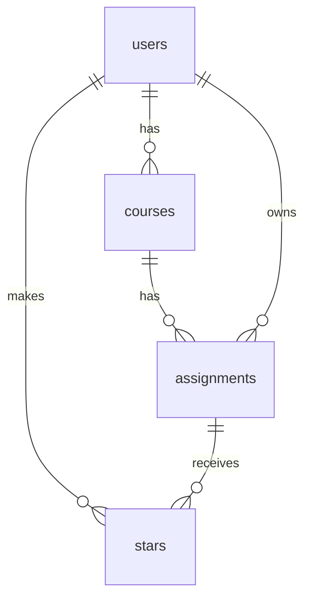

# PLAN.md: Course & Assignment Tracker

## 1. Pitch

**I'm building** a course & assignment tracker **because** I'm taking 7 classes this semester and my assignments are scattered across bCourses and syllabus PDFs. I need one place that shows what's coming up in the weeks ahead, so I can plan my workload and spot crunch weeks before they hit.

**How often:** twice a week. At the start of the week to plan what's due, and at the end of the week to update progress and look ahead.

## 2. Features

Numbered in the order I'll build them. Each one is its own Issue → branch → PR.

### Spine (required)

1. **Sign up and login:** As a student, I want to create an account and log in and out, so that my courses and assignments are private to me.
2. **Data model:** As a student, I want each assignment to belong to one of my courses, so that I can see my workload per class.
3. **Create / read / update / delete:** As a student, I want to add an assignment, see my list, open its detail page, edit it, and delete it (with an "are you sure?" prompt), so that my list matches the syllabus as things change.
4. **Validation:** As a student, I want a friendly message if I leave the title, course, or due date blank, so that I never save an assignment I can't plan around.
5. **Stars:** As a student, I want to star high-stakes assignments (midterms, projects) and view only starred ones, so that the big deadlines stand out.
6. **Find things:** As a student, I want to search assignments by title, filter by course or status, and sort by due date or newest added, so that I can answer "what's due next?" quickly.
7. **Dashboard:** As a student, I want a chart of assignments due per week plus summary stats (due this week, % completed this week, busiest upcoming week), so that I can spot crunch weeks in my weekly check-in.

### My 3 features

8. **Estimated hours:** As a student, I want to enter how many hours I expect each assignment to take, so that I can see my real workload per week, not just how many things are due.
9. **Crunch-week warning:** As a student, I want any week with more than 15 estimated hours due to be flagged, so that I can start early on those weeks.
10. **CSV import:** As a student, I want to upload a CSV of a course's assignments (title, due date, type, estimated hours), so that I don't have to type 7 syllabi in by hand.

## 3. Database

Four tables. Types are text, number, date, or true/false. Every table's primary key (PK) is a unique ID.

### `users`: one row per account
| Column | Type | Notes |
|---|---|---|
| `id` | text (unique ID) | **PK**, same ID as the Supabase login |
| `email` | text | |
| `display_name` | text | optional |
| `created_at` | date | set automatically |

### `courses`: my classes
| Column | Type | Notes |
|---|---|---|
| `id` | text (unique ID) | **PK** |
| `user_id` | text | **FK → users.id** |
| `name` | text | required, e.g. "Intro to Coding" |
| `code` | text | optional, e.g. "UGBA 196" |
| `instructor` | text | optional |
| `color` | text | color tag for the course, e.g. `#4F9DFF` |
| `created_at` | date | set automatically |

### `assignments`: the main item
| Column | Type | Notes |
|---|---|---|
| `id` | text (unique ID) | **PK** |
| `user_id` | text | **FK → users.id** |
| `course_id` | text | **FK → courses.id**, required |
| `title` | text | required, e.g. "Problem Set 4" |
| `type` | text | one of: homework, reading, quiz, exam, project, paper |
| `due_date` | date | required |
| `is_done` | true/false | defaults to false |
| `estimated_hours` | number | optional, added in feature 8 |
| `notes` | text | optional |
| `created_at` | date | set automatically |

### `stars`: junction table (who starred what)
| Column | Type | Notes |
|---|---|---|
| `id` | text (unique ID) | **PK** |
| `user_id` | text | **FK → users.id** |
| `assignment_id` | text | **FK → assignments.id** |
| `created_at` | date | set automatically |

A user can star the same assignment only once (`user_id` + `assignment_id` must be unique together).

### How the tables connect
- **users → courses:** one-to-many (one user has many courses)
- **courses → assignments:** one-to-many (one course has many assignments, and each assignment belongs to one course)
- **users ↔ assignments:** many-to-many through `stars` (a user can star many assignments, and each star row links one user to one assignment)

## 4. Tests

1. **Data isolation:** **Given** User A has a course and an assignment, **when** User B logs in and opens their assignment list, **then** User B sees none of User A's courses or assignments.
2. **Dashboard stat:** **Given** I have 3 assignments due this week (2 done, 1 not done) and 1 due next week, **when** I open the dashboard, **then** "Due this week" shows **3** and "% completed this week" shows **67%**.

## 5. Technologies

| What | Choice | Why |
|---|---|---|
| Coding agent | Claude Code | It works directly in my project folder and with Git/GitHub. |
| Code hosting | GitHub | Required. It holds my Issues, branches, and pull requests. |
| Framework | Next.js | One project handles both the pages and the server code. |
| Database | Supabase (Postgres) | Free tier, and it can block other users' rows at the database level. |
| Sign up / login | Supabase Auth, email + password | Built in, so I don't need to build a login system from scratch. |
| Hosting | Vercel | Free, and it redeploys automatically after each merge to `main`. |
| Styling | Tailwind CSS | Quick, consistent styling without writing separate CSS files. |
| Charts | Recharts | Simple chart library for the dashboard. |
| CSV import | PapaParse | Reliable CSV file reader for feature 10. |
| Tests | Vitest | Lightweight test runner that works with Next.js. |

## 6. Design

- **Look and feel:** dark mode by default (dark gray background, light text), clean and uncluttered.
- **Colors:** neutral dark base, and each course gets its own color tag so assignments are easy to scan. Red highlight for crunch weeks.
- **Inspiration:** Linear: dark, minimal, fast-feeling lists.

## 7. Risks and cuts

- **Least sure I can build:** CSV import (feature 10). Files can have missing columns, odd date formats, or course names that don't match.
- **Cut first if I run out of time:** CSV import, replaced with a smaller feature (a "due soon" banner for anything due in the next 3 days) so I still ship 3 of my own features.

---

## Plan vs. Reality

*Added at the end of the project. Everything above this line is my original plan, unchanged.*

| Planned feature | Shipped / Changed / Cut | Status | Learning | What changed and why (one line) |
|---|---|---|---|---|
| 1. Sign up and login | Shipped (changed) | Done | It was interesting to see the amount of setup needed for a seemingly simple task such as sign up or login: connecting through the Supabase project, initiating keys in the local environment, seeking out the right URL etc. Equally important to double-check config values before assuming the code is broken | Email confirmation turned **off** on purpose so classmates can try the app instantly; caught a Next.js 16 "Date.now() while prerendering" error and fixed it. |
| 2. Data model | Shipped (changed) | Done | Dependencies decide build order. Assignments can't exist without courses, so I had to build a courses page earlier than planned | Added a simple "My courses" page here, since assignments need courses to exist first; IDs became UUIDs and `created_at` became date + time (Supabase defaults). |
| 3. Create / read / update / delete | Shipped (changed) | Done | Thinking about how I'd use the app each week showed me features the plan initially missed, like ticking the assignments done straight from the list | Home page became the assignment list, and I added a done checkbox right on the list for quick weekly check-ins. |
| 4. Validation | Shipped (changed) | Done | Checking only the 'happy path' isn't enough: submitting bad data on purpose revealed a bug where the dropdowns reset after an error | Went beyond "not blank": due dates must be in this academic year and titles ≤ 120 characters; fixed a bug where dropdowns reset after an error. |
| 5. Stars | Shipped | Done | One 'stars' table links any user to any assignment, so one table handles everyone's stars instead of one table per user | Starred view became an `All / Starred ★` tab on the home page instead of a separate page. |
| 6. Find things | Shipped (changed) | Done | Filters live in the URL, so refresh or the back button doesn't lose them | Search updates as you type, the list defaults to "Not done", and "Sort by weight" became "Newest added" because I removed `weight_percent` while planning. |
| 7. Dashboard | Shipped (changed) | Done | Incorporating a time element to the app means that it's important to define "what day is it?", which in turn depends on where the server is | Weeks start Monday and the chart covers the whole semester; "today" uses Berkeley time because Vercel's servers run on UTC. |
| 8. Estimated hours | Shipped (changed) | Done | "Hours due" is a better workload measure than "number of assignments" because longer assignments require more upfront planning | Limited to 0.5–100 in half-hour steps, and added a 4th dashboard card plus an `Assignments / Hours` chart toggle. |
| 9. Crunch-week warning | Shipped (changed) | Done | I defined 'crunch' precisely: 'more than 15' and '15 or more' give different answers | Shows as a banner on the assignment list *and* the dashboard (red bars + a 15h line), counting all hours due that week. |
| 10. CSV import | Shipped (changed) | Done | This feature requires a lot of interaction with the user, hence the importance of a preview table: a preview lets me catch bad rows before they're saved | My riskiest feature shipped without the planned cut; added a preview table that skips bad rows, a template, and US-style dates; a stale dev build crashed the first import. |
| Test 1: data isolation | Shipped (changed) | Done | A test only proves something if you've seen it fail | Tests the real database security rules with two test users (5 checks); red run by temporarily adding an "anyone can read" rule. |
| Test 2: dashboard stat | Shipped (changed) | Done | A test must give the same answer every day, so instead of using the real date I fixed "today" to Nov 3 | Exactly the planned scenario (3 due, 67%) plus two edge cases; red run by removing the "this week" filter. |
| Backup: "due soon" banner | Cut | Backlogged | Having a named fallback made it less risky to attempt the hardest feature | Not needed: it was only the fallback if CSV import was cut. |
