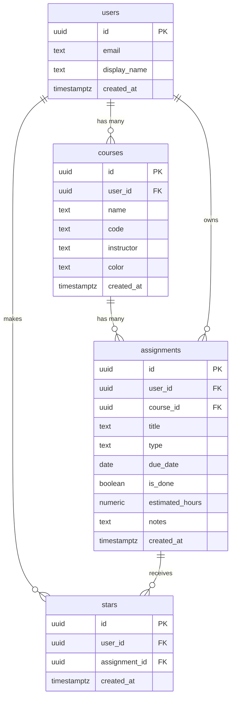

# Database schema

Course Tracker uses 4 tables in Supabase (Postgres). The SQL that built them is in `supabase/migrations/`, run in order: `0001` → `0004`.

## Diagram

## Tables

### `users`: one row per account
Created automatically when someone signs up (a database trigger copies the new login into this table).

| Column | Type | Notes |
|---|---|---|
| `id` | uuid (unique ID) | **Primary key.** Same ID as the Supabase login (`auth.users.id`) |
| `email` | text | Required |
| `display_name` | text | Optional |
| `created_at` | date + time | Set automatically |

### `courses`: a user's classes
| Column | Type | Notes |
|---|---|---|
| `id` | uuid | **Primary key** |
| `user_id` | uuid | **Foreign key → `users.id`**. Filled in automatically with the logged-in user |
| `name` | text | Required, can't be blank |
| `code` | text | Optional, e.g. "UGBA 196" |
| `instructor` | text | Optional |
| `color` | text | Color tag, e.g. `#6e79f2` (one of 8 choices) |
| `created_at` | date + time | Set automatically |

### `assignments`: the main item
| Column | Type | Notes |
|---|---|---|
| `id` | uuid | **Primary key** |
| `user_id` | uuid | **Foreign key → `users.id`** |
| `course_id` | uuid | **Foreign key → `courses.id`**, required |
| `title` | text | Required, can't be blank (the app also limits it to 120 characters) |
| `type` | text | One of: homework, reading, quiz, exam, project, paper |
| `due_date` | date | Required (the app also requires Aug 2026 – Jul 2027) |
| `is_done` | true/false | Defaults to false |
| `estimated_hours` | number | Optional, 0.5–100 in half-hour steps (added in feature 8) |
| `notes` | text | Optional |
| `created_at` | date + time | Set automatically |

### `stars`: junction table ("this user starred this assignment")
One table for everyone, not one per user.

| Column | Type | Notes |
|---|---|---|
| `id` | uuid | **Primary key** |
| `user_id` | uuid | **Foreign key → `users.id`** |
| `assignment_id` | uuid | **Foreign key → `assignments.id`** |
| `created_at` | date + time | Set automatically |

The same user can star the same assignment only once (`user_id` + `assignment_id` are unique together).

## How the tables relate (plain English)
- **users → courses: one-to-many.** One user has many courses. Each course belongs to one user.
- **courses → assignments: one-to-many.** One course has many assignments. Each assignment belongs to one course.
- **users ↔ assignments: many-to-many, through `stars`.** Each row in `stars` links one user to one assignment they starred.
- **Deleting cascades:** deleting a course deletes its assignments, and deleting an assignment deletes its stars.

## Security (row-level security)
Every table has row-level security turned on, so the **database itself** makes sure each user only sees and changes their own rows. It doesn't rely on the app's code alone.
- `users`: you can read and update only your own row.
- `courses`, `assignments`: you can read, add, edit, and delete only rows where `user_id` is you. You can only add an assignment to one of **your own** courses.
- `stars`: you can see, add, and remove only your own stars, and only star your own assignments.

The data-isolation test (`tests/data-isolation.test.ts`) checks these rules against the real database.

## Plan vs. what was built (PLAN.md section 3)
The agent built the 4 tables and relationships I designed. Differences:

| In PLAN.md | Built | Why |
|---|---|---|
| IDs as "text (unique ID)" | `uuid` | Supabase's standard ID type. "Text" was the closest of the four types the assignment lists |
| `created_at` as **date** | **date + time** (`timestamptz`) | Supabase's standard. It also allows "Newest added" sorting within the same day |
| `estimated_hours` listed in the plan | Added later, in feature 8 (`0004_estimated_hours.sql`) | As planned: it belongs to my feature 8, not the data-model PR |
| Rules only in the app | Rules **also** in the database | Blank names/titles, the 6 types, and the hours range are enforced by the database too, so bad data can't get in another way |
| Not in the plan | Row-level security policies, cascade deletes, the "add a users row on sign up" trigger, a unique rule on stars | Needed to make "each user sees only their own data" and the junction table actually work |
